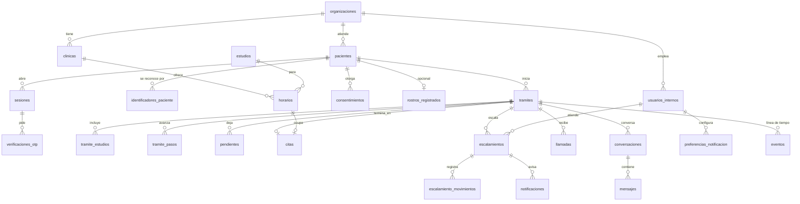

# Modelo de datos del motor de contexto (propuesta)

> **Estado: propuesta para revisar.** El esquema ejecutable está en
> [`db/esquema.sql`](../../db/esquema.sql) (PostgreSQL 15 o superior). Se probó en
> PostgreSQL 16: crea 32 tablas sin errores, y una prueba de humo confirmó que
> una organización no ve los datos de otra, que los eventos no se pueden modificar
> y que una escritura sin organización se rechaza. Sigue a
> [`FLUJO_Y_ENDPOINTS.md`](FLUJO_Y_ENDPOINTS.md).

## 1. Decisiones

| Decisión | Por qué |
|---|---|
| **PostgreSQL** (Cloud SQL o similar) en lugar de Firestore | El reto pide un modelo de datos claro. Hay transacciones para apartar horarios sin que dos canales tomen el mismo, restricciones que la base hace cumplir y *Row Level Security*. Para el tablero en tiempo real basta `LISTEN/NOTIFY` o SSE desde el backend |
| **Multiempresa desde el inicio** (`organizacion_id` en todo) | La plataforma se quiere vender a más redes de clínicas. RLS garantiza que una organización nunca vea a los pacientes de otra, aunque el código tenga un error |
| **Datos personales cifrados por la aplicación** | Nombre, teléfono, correo, CURP, RFC y el texto de los mensajes se guardan cifrados (`*_cifrado`, AES-GCM con llave en KMS). Para buscar por teléfono se usa un **índice ciego** (`*_hash` = HMAC del valor normalizado). Si alguien roba un respaldo, no lee nada |
| **Eventos de solo inserción** | `eventos` y `auditoria_accesos` tienen un trigger que impide `UPDATE` y `DELETE`. Es la trazabilidad del reto: qué pasó, cuándo y en qué canal |
| **El estado del trámite es una proyección** | `tramites` guarda el estado actual para leerlo rápido. Se actualiza en la misma transacción que inserta el evento, así que nunca contradice la línea de tiempo |
| **Ningún secreto en la base** | Códigos OTP, tokens de sesión y tokens de QR se guardan como hash. Las llaves de proveedores (Gmail, SMS, WhatsApp, Retell) van en un gestor de secretos, no en tablas |
| **El rostro no vive aquí** | Solo se guarda la referencia a la API facial v2 y el consentimiento con el que se registró (`rostros_registrados`) |

## 2. Diagrama



## 3. Tablas por tema

### 3.1 ¿A qué paciente se atendió? (identidad)

| Tabla | Qué guarda |
|---|---|
| `pacientes` | La persona: nombre, apellidos y fecha de nacimiento cifrados; sexo; nivel de identidad (`declarado`, `verificado`, `verificado_fuerte`); si se fusionó con otro registro |
| `identificadores_paciente` | Cada forma de reconocerla: teléfono, WhatsApp, correo, usuario de la app, CURP. Es la tabla que responde "¿quién es?" cuando llega un mensaje o una llamada. Un teléfono pertenece a un solo paciente por organización |
| `sesiones` | Cada visita en un canal. Una sesión web empieza anónima y se liga al paciente al verificarse |
| `consentimientos` | Aviso de privacidad, biometría, WhatsApp, SMS, correo y grabación de llamada, con la versión exacta del texto y la fecha de revocación |
| `rostros_registrados` | Referencia al rostro en la API facial v2 (`indice_v2`, `sujeto_id_v2`), nunca el vector |

Cómo se resuelve un mensaje de WhatsApp: se normaliza el número a `+52…`, se calcula
su HMAC y se busca en `identificadores_paciente` por `(organizacion_id, 'whatsapp', valor_hash)`.

### 3.2 ¿En dónde se quedó? (contexto)

| Tabla | Qué guarda |
|---|---|
| `tramites` | El trámite y su **estado**. Además, `paso_actual`, `siguiente_accion`, `canal_actual`, `canales_visitados`, `resumen_contexto` (anonimizado) y `version` (para que dos canales no se pisen) |
| `tramite_pasos` | Cada paso (estudio, clínica, horario, datos, orden médica, pago, preparación, confirmación, check-in), si está completo y **en qué canal** se completó |
| `pendientes` | Dudas o datos faltantes abiertos. Es lo primero que el siguiente canal le ofrece al paciente |
| `tramite_estudios` | Los estudios del trámite: uno, varios o los de un paquete |
| `citas` | La cita confirmada, con el token de QR (hash), el check-in y el motivo si se reagendó o canceló |
| `v_contexto_tramite` (vista) | Lo que devuelve `GET /pacientes/{id}/contexto`: trámite activo, estudio, clínica, horario, pendientes y escalamientos abiertos |

Ejemplo de Ana después de WhatsApp: `estado = pendiente_confirmacion`,
`paso_actual = confirmacion`, `siguiente_accion = confirmar_cita`,
`canales_visitados = {web, whatsapp}` y un pendiente abierto de tipo `pago`.

### 3.3 Catálogo

`estudios` (con `requiere_orden_medica` y `requiere_ayuno`), `paquetes` y
`paquete_estudios`, `precios_estudio` (con `precio_en_linea`, porque el sitio da un
descuento por pagar en línea) y `horarios` (con estado `apartado` y `apartado_hasta`
para retener el lugar mientras el paciente decide).

### 3.4 Conversaciones y llamadas

| Tabla | Qué guarda |
|---|---|
| `conversaciones` | Un hilo de web, WhatsApp o app. `atendida_por` dice si contesta el **bot** o un **asesor** |
| `mensajes` | El texto **cifrado** y con fecha de borrado (`borrar_despues_de`). La intención que detectó el NLP. El id de WhatsApp evita guardar dos veces el mismo mensaje |
| `llamadas` | Cada llamada de Retell: `call_id`, duración, motivo de fin y resumen anonimizado |

### 3.5 Escalamiento a un agente humano

Tabla `escalamientos`, con dos modalidades:

| Modalidad | Canales | Qué pasa |
|---|---|---|
| `en_vivo` | Web, WhatsApp, App | El bot detecta que el paciente pidió un humano, que no entendió dos veces o que es una queja. Pone la conversación en `en_espera_asesor`, crea el escalamiento y avisa a los asesores. El primero que lo toma queda en `asignado_a`, y la conversación pasa a `con_asesor`. El asesor ve el contexto completo y contesta desde el tablero por el mismo canal |
| `devolucion_llamada` | Llamada (Retell) | **No hay transferencia en vivo.** El agente de voz dice algo como: *"Voy a pasarle su caso a un asesor. Lo van a contactar a este mismo número muy pronto. ¿Le parece bien, o prefiere otro horario?"*. Se crea el escalamiento con el número de la llamada (`contacto_hash` y `contacto_cifrado`), el medio (`llamada`, `whatsapp` o `sms`) y el horario preferido si lo dijo. Los asesores reciben el aviso y uno devuelve la llamada |

Otros campos: `motivo`, `prioridad`, `estado` (`abierto` → `notificado` → `asignado` →
`en_atencion` → `resuelto`, o `contacto_fallido`, `cancelado`, `vencido`),
`sla_respuesta_vence_en` (p. ej. 5 minutos en vivo y 2 horas para devolución) e
`intentos_contacto`. Cada cambio se guarda en `escalamiento_movimientos` (quién lo
tomó, cada intento de llamada, notas).

Para repartir los casos, `usuarios_internos` tiene `disponibilidad` y
`max_casos_simultaneos`.

### 3.6 Notificaciones por SMS y Gmail

| Tabla | Qué guarda |
|---|---|
| `usuarios_internos` | Correo de trabajo (Gmail o Google Workspace) y teléfono para SMS de cada asesor |
| `preferencias_notificacion` | Qué avisos quiere cada asesor y por qué medio, por ejemplo "escalamiento nuevo por SMS solo si es prioridad alta, y por correo siempre" |
| `plantillas_notificacion` | Texto de cada aviso con variables (`{{folio}}`, `{{enlace}}`). **Sin datos de salud**: el aviso dice "Nuevo caso SD-2026-000123, prioridad alta" y un enlace al tablero, donde el asesor entra con su cuenta |
| `notificaciones` | La cola de salida: destinatario, medio (`sms`, `correo`, `whatsapp`), proveedor (`gmail`, `smtp`, `twilio`, `whatsapp_cloud`, `simulado`), estado, intentos, id del proveedor y último error. `clave_idempotencia` evita mandar el mismo aviso dos veces |

Flujo: al crear un escalamiento, en la misma transacción se insertan las filas de
`notificaciones` según las preferencias de los asesores disponibles. Un trabajador
las toma (`estado = pendiente`), las manda por la API de Gmail o el proveedor de SMS
y guarda el resultado. Si el SLA está por vencer y nadie tomó el caso, se avisa al
supervisor (`escalamiento_por_vencer`).

### 3.7 Trazabilidad y seguridad

| Tabla | Qué guarda |
|---|---|
| `eventos` | La línea de tiempo unificada (catálogo en `FLUJO_Y_ENDPOINTS.md` §4). Solo ids y valores de catálogo, nunca texto con datos de salud |
| `webhooks_recibidos` | Webhooks de WhatsApp y Retell ya procesados, para ignorar los reintentos |
| `auditoria_accesos` | Quién **leyó**, cambió, exportó o descifró datos de qué paciente, y por qué motivo |

## 4. OTP: qué es y cómo se guarda

**OTP** (*one-time password*, contraseña de un solo uso) es el código de 6 dígitos que
llega por SMS, WhatsApp o correo para probar que el teléfono o el correo son de quien
dice. Sirve, por ejemplo, para que alguien que escribe desde la web no pueda ver la
cita de otra persona solo con saber su número.

1. El paciente escribe su teléfono en la web.
2. El backend genera un código al azar, guarda **solo su hash** en
   `verificaciones_otp` (con caducidad de 5 minutos y máximo 5 intentos) y lo manda.
3. El paciente escribe el código. Si el hash coincide, la verificación se marca como
   consumida, el identificador queda `verificado` y la sesión anónima se liga al
   paciente.
4. Límite de envíos por número (p. ej. 3 cada 10 minutos), con el índice sobre
   `destino_hash`, para que nadie use el sistema para mandar SMS sin control.

En WhatsApp no hace falta OTP: si el mensaje llega desde ese número, el número ya
está probado. En la llamada, el número que marca sirve para **leer** el contexto,
pero un cambio sensible (otro teléfono, otro titular) pide OTP.

## 5. Datos que pide Salud Digna al agendar

No se pudo abrir `salud-digna.org` desde el entorno de trabajo: el sitio no
respondió a la descarga automática. Los campos de abajo salen de **guías no oficiales**
que describen el proceso, así que hay que confirmarlos en el sitio oficial
(https://www.salud-digna.org/citas) antes de la demo.

| Dato | Dónde aparece | En el esquema |
|---|---|---|
| Nombre (y apellidos) | [tu-salud-digna.com](https://tu-salud-digna.com/citas/), [comosecontrata.com](https://www.comosecontrata.com/agendar-cita-salud-digna-mexico/) | `pacientes.nombre_cifrado`, `apellidos_cifrado` |
| Fecha de nacimiento | tu-salud-digna.com. También se pide para reagendar o cancelar ([citassaluddigna.com.mx](https://citassaluddigna.com.mx/)) | `pacientes.fecha_nacimiento_cifrada` |
| CURP "si aplica" | tu-salud-digna.com | `identificadores_paciente` con tipo `curp` |
| Correo electrónico | tu-salud-digna.com, comosecontrata.com | `identificadores_paciente` con tipo `correo` |
| Teléfono | comosecontrata.com (preguntas frecuentes) | `identificadores_paciente` con tipo `telefono` |
| Estudio o paquete | Las tres guías. Por WhatsApp se elige "estudio individual" o "paquete" | `tramite_estudios`, `paquetes` |
| Sucursal (filtrada por estado y ciudad) | Las tres guías | `clinicas.estado_mx`, `ciudad`; `tramites.clinica_id` |
| Fecha y hora | Las tres guías | `horarios`, `tramites.horario_id` |
| Orden médica (resonancia, algunas tomografías, biopsias) | tu-salud-digna.com | `estudios.requiere_orden_medica`, `documentos`, `tramite_estudios.orden_medica_id` |
| Preparación (ayuno, vejiga llena, medicamentos) | tu-salud-digna.com, comosecontrata.com | `estudios.preparacion`, `requiere_ayuno`; paso `preparacion_leida` |
| Método de pago: tarjeta, OXXO Pay, Coppel Pay o en clínica (sin el descuento en línea) | tu-salud-digna.com, citassaluddigna.com.mx | `tramites.metodo_pago`, `estado_pago`; `precios_estudio.precio_en_linea` |
| Cuenta (registro e inicio de sesión) | citassaluddigna.com.mx | Sesión verificada con OTP; no se guardan contraseñas |
| Folio de cita, fecha de nacimiento y motivo para reagendar o cancelar | citassaluddigna.com.mx | `tramites.folio`, `citas.motivo_cambio` |
| Identificación oficial **al llegar** a la clínica | tu-salud-digna.com | Check-in en recepción; `documentos` con tipo `identificacion` si se escanea |

Agregados que las guías no mencionan pero un trámite real suele necesitar:

- **Agendar para otra persona** (un hijo, un padre): `tramites.solicitante_paciente_id`
  y `parentesco_solicitante`.
- **Facturación** (RFC, razón social, régimen, código postal, uso de CFDI):
  `datos_facturacion`, cifrado y opcional.

## 6. Cómo probarlo

```bash
createdb motor_contexto
psql -d motor_contexto -v ON_ERROR_STOP=1 -f db/esquema.sql
```

La aplicación debe conectarse con un rol **sin** `BYPASSRLS` y abrir cada transacción
con `SET LOCAL app.organizacion_id = '<uuid>'`. Sin esa variable, las consultas no
devuelven filas y las escrituras se rechazan.

## 7. Pendiente de decidir

1. Confirmar los campos del formulario oficial de Salud Digna (sección 5).
2. Proveedor de SMS (Twilio u otro) y si los correos salen por la API de Gmail con una
   cuenta de servicio de Workspace o por SMTP.
3. Tiempos de SLA de cada modalidad de escalamiento.
4. Cuánto tiempo se guardan mensajes, resúmenes de llamada y documentos.
